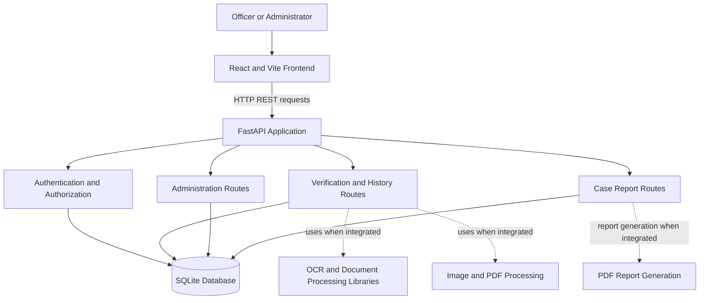

# SecureX — Technical Design Document

## 1. Purpose

SecureX is a web application intended to support document verification workflows, officer and checkpost management, verification history, and case reporting. Automated document analysis should provide evidence for human review rather than independently declare a document fraudulent.

## 2. Technology Stack

### Frontend
- React
- Vite
- JavaScript
- React Router
- Lucide React
- Leaflet and React Leaflet
- Tesseract.js dependency for browser-based OCR functionality where integrated

### Backend
- Python
- FastAPI
- SQLAlchemy
- PyJWT
- pwdlib with Argon2 support
- OpenCV, Pillow, PyMuPDF, pytesseract, pyzbar, and ReportLab dependencies for document processing and reporting where integrated

### Database
- SQLite
- SQLAlchemy ORM
- Database file: `backend/securex.db`

## 3. Architecture



The diagram represents the intended component relationships. Confirm individual processing integrations against the implementation before treating them as completed features.

## 4. Backend Entry Point

The FastAPI application starts from `backend/app/main.py`.

Current registered routers:
- `app.routers.auth`
- `app.routers.admin`
- `app.routers.history`
- `app.routers.case_reports`

Current utility endpoints:
- `GET /`
- `GET /api/health`

Interactive API documentation is normally available at `/docs`.

At startup, SQLAlchemy creates missing database tables using the registered models.

## 5. Data Model

### Checkpost
- `id`: primary key
- `name`: unique checkpost name
- `address`: address
- `latitude`, `longitude`: optional coordinate strings
- `is_active`: active status
- `created_at`: creation timestamp

Relationships: one checkpost can be associated with multiple officers and verifications.

### Officer
- `id`: primary key
- `officer_id`: unique officer reference
- `full_name`: officer name
- `email`: unique email address
- `password_hash`: password hash, not plaintext
- `designation`: designation
- `checkpost_id`: optional checkpost assignment
- `account_status`: approval workflow status
- `is_active`: account active status
- `is_admin`: administrator flag
- `created_at`: creation timestamp

### Verification
- `id`: primary key
- `verification_number`: unique reference
- `officer_id`: associated officer
- `checkpost_id`: associated checkpost
- `document_type`: submitted document category
- `original_filename`: original upload filename
- `status`: workflow status
- `ocr_text`: optional extracted text
- `review_notes`: optional review notes
- `created_at`: creation timestamp

### CaseReport
- `id`: primary key
- `report_number`: unique case reference
- `officer_id`: reporting officer
- `case_type`: incident category
- `description`: incident description
- `latitude`, `longitude`: optional location coordinates
- `location_description`: optional location details
- `status`: report workflow status
- `created_at`: creation timestamp

## 6. Authentication and Security

The current security module uses:
- Password hashing through `pwdlib`
- JWT tokens signed with HS256
- A 30-minute access-token expiry

The signing key is read from the `CARECIRCLE_SECRET_KEY` environment variable. The current code has a hardcoded development fallback. Remove that fallback and require a strong secret before production deployment.

Additional requirements before production:
- Verify authorization on every protected endpoint.
- Restrict access to each officer's permitted records.
- Validate uploaded file content and size.
- Store uploads outside public web directories.
- Avoid logging passwords, tokens, full identity numbers, or extracted sensitive document contents.
- Use HTTPS in production.
- Add rate limiting and appropriate session/token revocation controls.
- Define a retention policy and secure deletion workflow.
- Use synthetic data for demonstrations and tests.

## 7. Configuration

Backend dependencies are listed in `backend/requirements.txt`.

Frontend dependencies and scripts are defined in `frontend/package.json`.

The current database connection is constructed directly in `backend/app/database.py`. It uses a SQLite file under the backend directory. A separate database URL configuration has not yet been confirmed.

The `.env.example` file documents the JWT signing key. The application currently reads the key from the process environment; an example file alone does not load environment variables automatically.

## 8. Local Development

### Backend
From the repository root:

```powershell
cd backend
python -m venv .venv
.\.venv\Scripts\Activate.ps1
python -m pip install -r requirements.txt
python -m uvicorn app.main:app --reload
```

If a virtual environment already exists, activate that environment instead of creating another.

Set a local JWT secret in the same PowerShell session before starting the backend. Do not use the example placeholder as a real secret.

### Frontend
Open a second terminal:

```powershell
cd frontend
npm install
npm run dev
```

The Vite development server normally uses `http://localhost:5173`.

## 9. Testing Strategy

Use authorized synthetic documents only. Test:
- Valid and invalid login attempts
- Officer approval and access restrictions
- Checkpost assignment rules
- Verification creation and history access
- Case report creation and status updates
- Unsupported and oversized uploads
- Corrupt or malformed PDFs and images
- OCR failures and low-quality scans
- QR decoding errors
- Documents with known, intentionally introduced changes
- PDF report generation, if integrated

Record measured accuracy and false-positive rates only after running an evaluation with known ground-truth data.

## 10. Limitations

OCR output can contain errors. Metadata, image anomalies, QR readability, and layout differences are not proof of forgery. An unsigned document is not automatically fake. Official issuer verification requires a supported, authorized integration.

A trained tampering-detection model, calibrated risk probabilities, and official issuer integrations must not be claimed unless implemented and evaluated.

## 11. Future Improvements

- Add automated tests and CI checks.
- Add a configurable database connection for PostgreSQL migration.
- Add secure private file storage and retention controls.
- Add reproducible document-analysis evaluations.
- Add audit logging and security monitoring.
- Document every API endpoint and authorization rule.
